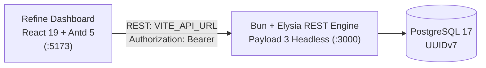

# payload-elysia-refine

Payload CMS 3 running headless inside an **ElysiaJS server on Bun**, consumed by a **Refine + Ant Design** admin dashboard that replaces the Payload admin UI.

```
payload-elysia-refine/
├── api/        # Bun + Elysia + Payload 3 REST API (no admin UI, no Next.js)
├── dashboard/  # Vite + React 19 + Refine v5 + Ant Design 5 admin dashboard
└── package.json
```

## Architecture



- ⚡ **API**: Headless Payload 3 REST engine on Bun + Elysia (no admin UI, no Next.js).
- 🔒 **Auth**: Superadmin JWT Bearer token authentication (`Authorization: Bearer <token>`), 1-hour expiry, session revoked on logout. Cookies and API keys are disabled.
- 📊 **Database**: PostgreSQL with UUID v7 ids and Drizzle custom aggregations (`/api/posts/stats`).
- 🧭 **Docs**: Scalar OpenAPI interactive docs at `/api/docs`; the URL is printed on boot in `development` and `uat` (UAT requires basic auth, production serves 404).

## Collections & auth semantics

- **users** — public self-registration (role forced to `guest`), superadmin-only role field / delete; read & update for guests are scoped to their own document server-side. API keys are disabled.
- **posts** — CRUD is superadmin-only, read is public; slug uniqueness and kebab-case validation; `GET /api/posts/stats` (Drizzle aggregate) gated behind authentication.
- **Role uplift protection**: no non-superadmin (and no anonymous registration) can ever set `role: 'superadmin'`.
- **Sessions**: JWTs are backed by server-side sessions, so logout revokes the token immediately.

## Getting started

```bash
bun install

# create the database once
psql -h 127.0.0.1 -U postgres -c 'CREATE DATABASE payload_elysia'

cp .env.example api/.env   # adjust DATABASE_URI / PAYLOAD_SECRET / INITIAL_ADMIN_* as needed

bun run dev:api       # http://localhost:3000/api
bun run dev:dashboard # separately: Refine dashboard on http://localhost:5173
```

Migrations (including seeding the initial superadmin and sample post via `api/src/migrations/20261019_000000_seed.ts`) execute automatically on server boot.

Local development seed: `admin@example.com` / `password123`, taken from `INITIAL_ADMIN_EMAIL` / `INITIAL_ADMIN_PASSWORD` in `.env`. The admin seed is skipped with a warning when those variables are unset.

## Scripts

| Where | Command | What |
| --- | --- | --- |
| root | `bun run lint` / `lint:fix` | Biome check across both workspaces |
| root | `bun run test` | API test suite (unit + live REST parity tests) |
| root | `bun run dev:api` / `dev:dashboard` | Run one server each |
| api/ | `bun run generate:types` | Regenerate `src/payload-types.ts` |
| api/ | `bun run generate:openapi` | Write `openapi.json` from the `/openapi.json` endpoint |
| api/ | `bun run migrate:status` | Check applied and pending migration status |
| dashboard/ | `bun run typecheck` | `tsc --noEmit` |

## Environment variables

All API runtime behavior is env-driven (`api/.env` in development, container/CLI env in deployment):

| Variable | Used by | Purpose |
| --- | --- | --- |
| `DATABASE_URI` | API | Postgres connection string. Must align with `PGUSER` (the pool applies `PGUSER` over the URI's user). |
| `PGUSER` | API | Explicit pg pool user; keep it identical to the user embedded in `DATABASE_URI`. |
| `PAYLOAD_SECRET` | API | JWT signing / crypto secret. Required and at least 32 characters. |
| `PORT` | API | Elysia HTTP port (default `3000`). |
| `SERVER_URL` | API | Canonical API origin exposed to clients (default `http://localhost:3000`). |
| `DASHBOARD_URL` | API | Dashboard's real origin for the CORS allowlist. |
| `INITIAL_ADMIN_EMAIL` | API | Initial superadmin email. The admin seed is skipped when unset. |
| `INITIAL_ADMIN_PASSWORD` | API | Initial superadmin password, used together with `INITIAL_ADMIN_EMAIL`. |
| `APP_ENV` | API | `development` / `uat` / `production`; gates the basic-auth-protected `/api/docs`. |
| `VITE_API_URL` | dashboard | Direct base REST API URL consumed by the dashboard client (default `http://localhost:3000`). |

**Cross-origin rule in production:** the dashboard calls the API directly with a Bearer token, so `DASHBOARD_URL` must match the exact deployed dashboard origin (scheme included). It feeds the CORS allowlist; a mismatch blocks browser calls to the API.

## Deployment

### API with Docker

The Dockerfile builds from the repo root (the `api/` workspace member resolves through the root `bun.lock`):

```bash
cp .env.example .env   # set PAYLOAD_SECRET and APP_ENV; set INITIAL_ADMIN_* to seed the admin
docker compose up --build
# → db (postgres:17-alpine, healthcheck) + api on http://localhost:3000/api
```

First startup executes pending database migrations automatically (including the initial superadmin when `INITIAL_ADMIN_EMAIL` / `INITIAL_ADMIN_PASSWORD` are set, plus a sample post) and then serves. For a standalone image: `docker build -t payload-elysia-api .` and supply `DATABASE_URI` / `PGUSER` / `PAYLOAD_SECRET` / `DASHBOARD_URL` / `INITIAL_ADMIN_EMAIL` / `INITIAL_ADMIN_PASSWORD` yourself (hosted Postgres like Neon/Railway works — no compose needed, just the connection string).

> Note: this image was authored without a locally available Docker daemon — smoke-test it on your deployment host before relying on it.

### Dashboard on Vercel

1. Import the repo into Vercel; set **Root Directory = `dashboard`** (framework: Vite, build `bun run build`, output `dist`).
2. Set the `VITE_API_URL` environment variable to the deployed API origin (for example `https://api.example.com`). The dashboard calls that REST API directly.
3. On the API side, set `DASHBOARD_URL` to the deployed Vercel URL, `SERVER_URL` to the API's public URL, and make sure `DASHBOARD_URL` is in the CORS allowlist.

## Notes

- **Why `--conditions=development` everywhere**: payload packages ship a dev-bundle ESM build that resolves their circular imports correctly under Bun; CLI scripts in the source project carry the same flag.
- **Migrations & Seeding**: Database migrations in `api/src/migrations/*.ts` run automatically on server startup via `executePendingDatabaseMigrations`. `20261019_000000_seed.ts` seeds the superadmin user only when `INITIAL_ADMIN_EMAIL` / `INITIAL_ADMIN_PASSWORD` are set, and always seeds the initial post idempotently.
- **JWT auth only**: Requests authenticate with `Authorization: Bearer <token>`. Cookie-based auth and API keys are disabled, so CSRF does not apply. JWTs expire after 1 hour and logout revokes the server-side session; the dashboard stores the token in `sessionStorage`.
- **No GraphQL, uploads, globals, drafts/versions** — deliberately out of scope of the source project's API surface.
